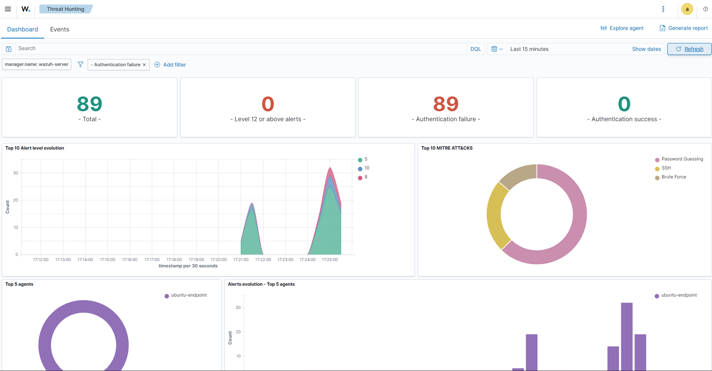
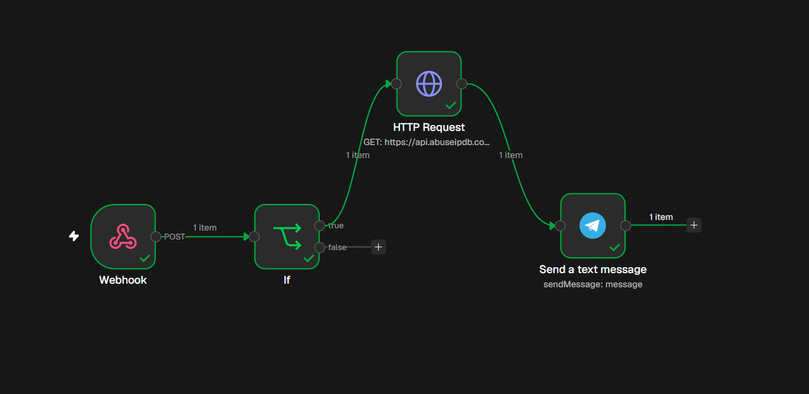
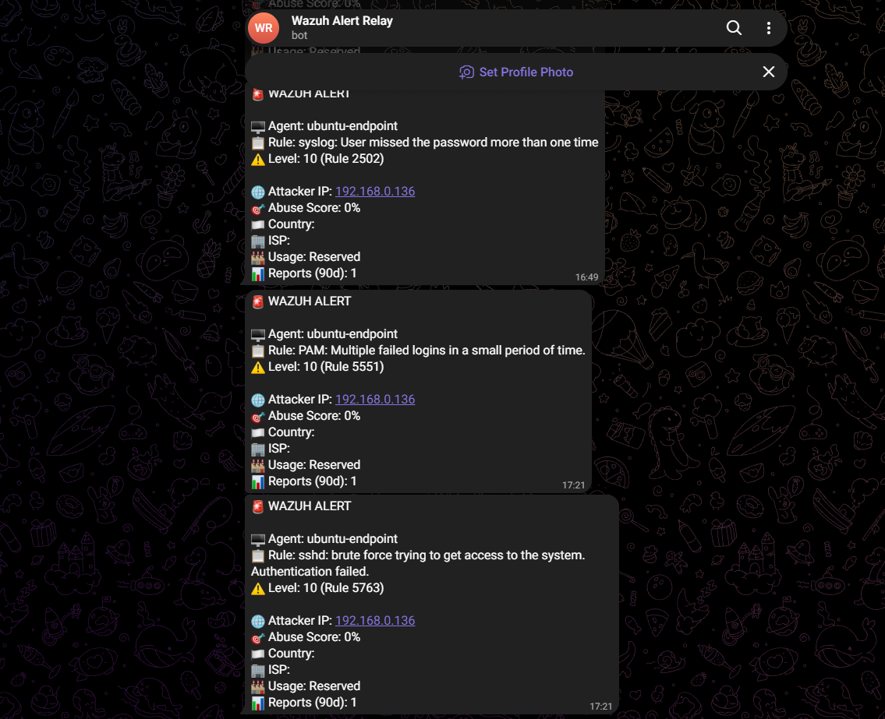
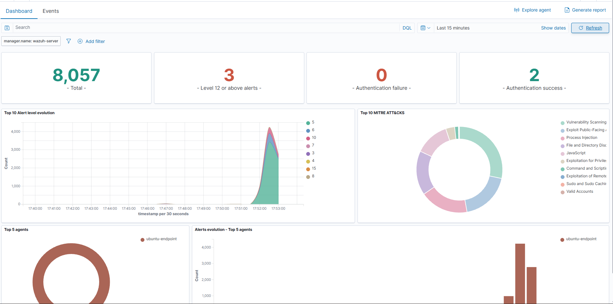
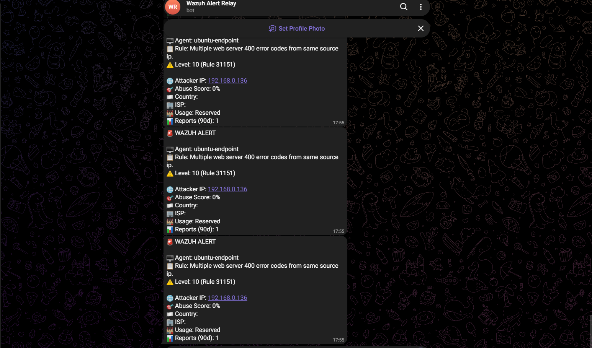

# 🛡️ SOC Home Lab — Wazuh SIEM + n8n SOAR

A home-built Security Operations Center (SOC) that automatically **detects cyber attacks**, enriches them with **threat intelligence**, and sends **real-time alerts to Telegram** — with no manual work.

I built this from scratch to understand how real security teams detect and respond to attacks, not just read about it.



---

## 📌 Overview

This lab recreates how a real SOC works, using free and open-source tools:

- A **SIEM** (Wazuh) detects attacks from system logs
- A **SOAR** tool (n8n) automates the response
- A **threat intel** API (AbuseIPDB) checks if the attacker is a known bad actor
- **Telegram** delivers instant alerts to my phone

When an attack happens on the monitored machine, the entire chain runs by itself.

---

## 🏗️ Architecture

```
┌──────────────┐     attacks      ┌───────────────────┐
│  Kali Linux  │ ───────────────► │  Ubuntu Endpoint  │
│  (attacker)  │                  │   (Wazuh agent)   │
└──────────────┘                  └─────────┬─────────┘
                                            │ logs
                                            ▼
                                  ┌───────────────────┐
                                  │   Wazuh Server    │
                                  │      (SIEM)       │
                                  └─────────┬─────────┘
                                            │ level 7+ alerts
                                            ▼
                                  ┌───────────────────┐
                                  │        n8n        │
                                  │      (SOAR)       │
                                  └─────────┬─────────┘
                                   enrich   │   notify
                          ┌─────────────────┴─────────────────┐
                          ▼                                    ▼
                  ┌──────────────┐                    ┌──────────────┐
                  │  AbuseIPDB   │                    │   Telegram   │
                  │(threat intel)│                    │    (alert)   │
                  └──────────────┘                    └──────────────┘
```

The automation workflow in n8n:



---

## 🧰 Tech Stack

| Component | Tool | Role |
|-----------|------|------|
| SIEM | Wazuh 4.14 | Detects attacks from logs |
| SOAR | n8n (Docker) | Automates the response |
| Threat Intel | AbuseIPDB | Checks attacker IP reputation |
| Alerting | Telegram Bot | Delivers notifications |
| Endpoint | Ubuntu Server | Monitored "victim" machine |
| Attacker | Kali Linux | Runs the attack simulations |

---

## ⚙️ How It Works

1. The **Wazuh agent** on Ubuntu reads system logs (e.g. `/var/log/auth.log`, Apache logs).
2. The **Wazuh server** analyses them and raises an alert when one matches a rule.
3. Alerts of **level 7 or higher** trigger a custom integration script (`custom-n8n`).
4. The script forwards the alert to **n8n** through a webhook.
5. n8n **filters** the alert, looks up the attacker IP on **AbuseIPDB**, and **throttles** repeats.
6. A clean, readable alert is sent to **Telegram**:



---

## 🎯 Attacks Simulated

| # | Attack | Tool | Detected? |
|---|--------|------|-----------|
| 1 | Port scan (reconnaissance) | Nmap | ❌ Not by host-based SIEM* |
| 2 | SSH brute force | Hydra | ✅ Yes (rule 5763, level 10) |
| 3 | SSH brute force | Metasploit | ✅ Yes (PAM rule) |
| 4 | SSH brute force | Medusa | ✅ Yes (max-auth rule) |
| 5 | Web vulnerability scan | Nikto | ✅ Yes (web attack rules) |

\* **Key lesson:** a host-based SIEM can't see a quiet network scan because it leaves no log entry. This is exactly why a network IDS (Suricata) is next on the roadmap.

Wazuh automatically maps each attack to **MITRE ATT&CK** techniques:



---

## 💡 Key Findings

- **Host-based vs network detection:** Wazuh caught login and web attacks but was blind to the Nmap port scan. Full coverage needs a network IDS too.
- **Alert fatigue is real:** a single Nikto scan generated **8,000+ alerts** and flooded Telegram. I added **IP-based rate-limiting** in n8n, bringing it down to ~2 alerts per attack.
- **MITRE ATT&CK mapping:** Wazuh automatically mapped the attacks to techniques such as Brute Force (T1110) and Password Guessing.

The flood before the fix, and the throttle (a small n8n Code node) that solved it:



---

## 🚀 Roadmap

- [ ] Add **Suricata** (network IDS) to catch port scans and network-level attacks
- [ ] Re-run the attacks to show detection **before vs after** Suricata
- [ ] Use **Atomic Red Team** for automated, MITRE-mapped attack simulation
- [ ] Add **YARA** rules for malware detection
- [ ] Add a **Windows endpoint** with **Sysmon** for richer Windows telemetry

---

## 📚 What I Learned

- How a **SIEM** and **SOAR** work together in a real detection-and-response pipeline
- Writing a **custom integration** to connect two security tools
- **Threat intelligence enrichment** using a real API
- Hands-on **Linux** (permissions, services, SSH) and **Docker**
- Why **alert tuning** matters — by running into the problem myself

---

## 📸 More Screenshots

All screenshots are in the [`screenshots/`](screenshots/) folder:

| File | Shows |
|------|-------|
| `01-wazuh-overview.png` | Wazuh dashboard overview |
| `02-agent-active.png` | Monitored endpoint connected |
| `03-n8n-workflow.png` | The SOAR automation workflow |
| `04-telegram-alert.png` | Automated Telegram alert |
| `05-nmap-scan.png` | Nmap port scan (Kali) |
| `06-nmap-not-detected.png` | Host-based SIEM blind spot |
| `07-metasploit-bruteforce.png` | Metasploit SSH brute force |
| `08-medusa-bruteforce.png` | Medusa SSH brute force |
| `09-brute-force-detected.png` | Brute force detected in Wazuh |
| `10-nikto-webscan.png` | Nikto web vulnerability scan |
| `11-mitre-attack-mapping.png` | MITRE ATT&CK technique mapping |
| `12-alert-fatigue-flood.png` | Alert flood (before throttling) |
| `13-throttle-code.png` | The rate-limiting fix in n8n |

---

## ⚠️ Disclaimer

This is a learning lab built on **isolated virtual machines that I own**. Every attack was performed against **my own systems**. Never attack systems you do not have explicit permission to test.

## Acknowledgements
Built as a self-learning project, with Claude (AI) used as a study assistant to explain concepts along the way.
